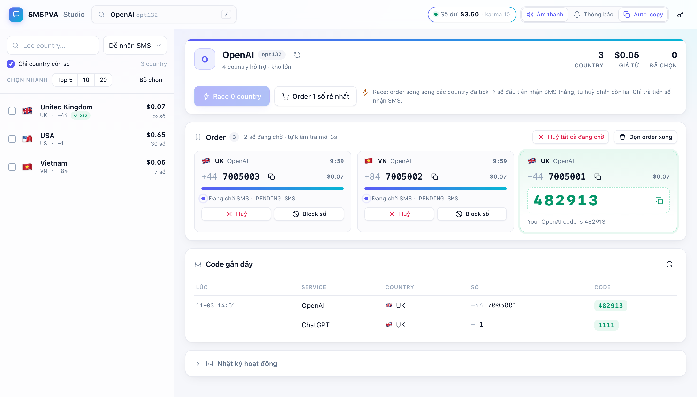
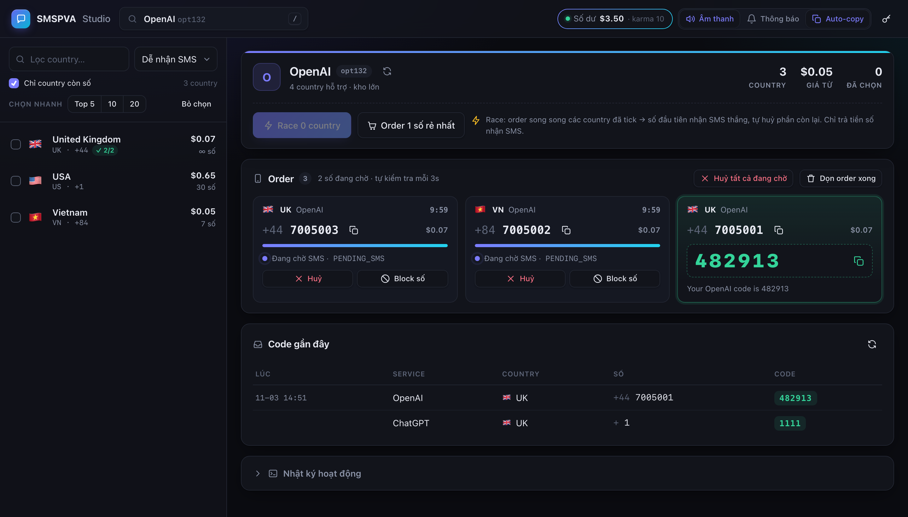

# SMSPVA Studio

Dashboard local, gọn và đẹp cho [SMSPVA](https://smspva.com) — thuê số nhận SMS cho **mọi service** (ChatGPT/OpenAI, Telegram, WhatsApp, Google…), order song song nhiều country × nhiều service cùng lúc.

> Công cụ cá nhân, không chính thức — không liên kết với SMSPVA.

<p align="center">
  
  
</p>

## Tính năng

- **Command palette chọn service** (`⌘K` trên macOS, `Ctrl+K` trên Windows/Linux, hoặc phím `/`): tìm theo tên hoặc mã `optXX`, giá thấp nhất, số country, kho số; ★ ghim service hay dùng.
- **Tab service** dính trên đầu: service vừa dùng, đang tick, đang có số chờ (kèm badge số lượng) — chuyển bằng click, `Alt/⌥+1–9` hoặc `[` `]`; chuyển tab hiện ngay nhờ cache.
- **Danh sách country** còn số: giá, kho, operator, kèm **lịch sử nhận SMS của chính bạn** để chọn country dễ nhận nhất.
- **Order hàng loạt**: tick country ở nhiều service (tick được giữ khi đổi service), chọn số lượng mỗi country, order tất cả song song. Có thể chạy nhiều lô cùng lúc. **Không bao giờ tự huỷ số** — kể cả khi tắt server; số nào không cần thì bấm Huỷ.
- **Theo dõi order realtime**: đếm ngược, tự poll `/activation/orders` mỗi 3s (kể cả order tạo trên web SMSPVA), huỷ / block số.
- Có SMS → **âm thanh, thông báo desktop, tự copy code**.
- Hỗ trợ **API v2** và **key kiểu cũ** (`priemnik.php`) — tự nhận diện.
- Light / dark mode theo hệ thống, responsive cho mobile.

## Chạy

Chỉ cần Python 3.9+ — không có dependency ngoài.

```bash
python3 web.py
# mở http://127.0.0.1:8765 và nhập API key (SMSPVA → Profile → API key)
```

Đổi cổng: `PORT=9000 python3 web.py`. Bookmark service: `http://127.0.0.1:8765/?service=opt132`.

## Bảo mật

- Server chỉ nghe `127.0.0.1` và từ chối request có `Host`/`Origin` lạ.
- API key chỉ giữ trong RAM, không ghi ra đĩa.
- Lịch sử order lưu cục bộ ở `orders.jsonl` (đã có trong `.gitignore`).

## Cấu trúc

| File | Vai trò |
| --- | --- |
| `web.py` | HTTP server + logic order hàng loạt / poll |
| `smspva.py` | Client SMSPVA (API v2 + API cũ), rate-limit, lịch sử |
| `index.html` | Giao diện (HTML/CSS/JS thuần, không build) |
| `legacy_data.json` | Bản lưu danh sách service/country cho key kiểu cũ |
